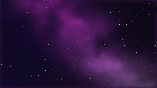

# claude-image-theme

**English** · [Tiếng Việt](README.vi.md)

Turn any picture into a theme mod for Claude (Claude Code in the desktop and mobile apps).
Give it one image and it:

1. **Extracts the dominant palette** (k-means over the picture).
2. **Picks harmonious colors**: page/card/panel surfaces tinted with the picture's main hue, readable text, and accent / success / warning / danger / pro colors that keep their meaning but lean toward the picture.
3. **Uses the picture as the background.** Themes cannot embed bitmaps, so the picture is redrawn as vector art that stays close to the photo: a smooth, blurred base layer carries the gradients, and about 5,000 fine cells add detail only where the picture has edges (planets, silhouettes, nebulae). The picture's bright points become slowly twinkling stars.
4. **Adds a veil** over it (dark in dark mode, light in light mode) and **frosted glass** panels with bright borders, so chat text stays readable.
5. **Checks contrast** with the design system's own color builder and nudges colors until the app accepts the theme.
6. **Adds a panel inside Claude**, opened from a Theme button above the message box: pick another picture with the file dialog, and tune veil, glass, blur, picture detail, accent color, mode, stars, drift and borders live. Your choices are kept for next time.

The result is a ready-to-load mod folder: palette, chat frame, borders, buttons and text all follow your picture, much like the custom space themes in Antigravity.



## Requirements

- Node.js 18 or newer
- Claude Code with mods (plugin hooks) support. Themes draw in the **desktop** and **mobile** apps; the terminal does not draw themes.

## Quick start

```bash
git clone https://github.com/ddtam2604work/claude-theme-from-image.git
cd claude-theme-from-image
npm install
node bin/generate.mjs "C:\Users\<you>\Pictures\space.jpg" --name space
```

Output:

```
Palette: #000b0e 31%, #001e2b 28%, #00362a 21%, #012852 6%, ...
  dark  text-primary on surface-0 16.8:1, text-muted on surface-0 8.8:1
Scene: 320x180 grid, 5650 cells, 108855 characters
Mod written to: ~/.claude/image-themes/image-theme-space
```

Then load the mod:

```bash
claude --plugin-dir ~/.claude/image-themes/image-theme-space
```

For a session started by the desktop app, add the folder to `CLAUDE_CODE_PLUGIN_DIRS` (in your environment, or the `env` block of `~/.claude/settings.json`):

```json
{ "env": { "CLAUDE_CODE_PLUGIN_DIRS": "C:\\Users\\<you>\\.claude\\image-themes\\image-theme-space" } }
```

Open `preview.svg` inside the mod folder in a browser to see the backdrop before loading it.

### Try the bundled example

This repository is also a plugin marketplace with one example theme, **Nebula**, made from `samples/nebula.png` (an original, procedurally painted picture). At the prompt of a Claude Code session:

```
/plugin install image-theme-nebula --marketplace ddtam2604work/claude-theme-from-image
```

or from a shell:

```bash
claude plugin install image-theme-nebula --marketplace ddtam2604work/claude-theme-from-image
```

## The panel inside Claude

Everything can be done from inside the app, without the command line:

- A **Theme** button sits above the message box. Click it to open the panel beside the chat (or type the mod's command, for example `/image-theme-space`). The panel also opens by itself the first time the theme loads.
- **Choose picture…** opens your system's file dialog. Pick a `.jpg` or `.png` and the theme is rebuilt from it in a few seconds: new palette, new colors, new backdrop. You can also paste a path into the field below it. **Original picture** goes back to the one the mod was made from.

| Control | What it changes |
| --- | --- |
| On / Off | Turns the theme on or off |
| Choose picture… / path | Rebuilds the theme from another picture (needs Node.js 18+ on the PATH) |
| Darkness over the picture | Dark-mode veil, 0–95 % (− / + in 5 % steps) |
| Light veil | The veil in light mode |
| Panel glass opacity | How solid the frosted panels are |
| Blur behind panels | 0–64 points |
| Picture detail | Sharp, Medium or Soft |
| Accent color | From the picture, or one of its vivid colors |
| Mode | Follow the app, always dark, or always light |
| Twinkling stars, Slow drift, Bright borders | Toggles |
| Button above prompt | Shows or hides the Theme button (also hidden with its own Hide) |
| Reset | Back to the starting values |

Changes apply at once and are saved for later sessions. `/image-theme-space off` and `/image-theme-space on` turn the theme off and on from the prompt.

## Generator options

| Option | Default | What it does |
| --- | --- | --- |
| `--name <slug>` | file name | Theme id; the mod is named `image-theme-<slug>` |
| `--label <text>` | from name | Name shown in the app |
| `--out <folder>` | `~/.claude/image-themes` | Where the mod folder goes |
| `--lang en\|vi` | `en` | Language of the settings pane |
| `--mode both\|dark\|light` | `both` | Build both color modes, or one |
| `--detail <160..480>` | `320` | Resolution of the redrawn picture |
| `--colors <32..200>` | `120` | Colors in the redrawn picture |
| `--stars <n>` | `120` | Bright points kept as stars |
| `--veil`, `--veil-light`, `--glass`, `--blur`, `--softness`, `--still` | | Starting values for the pane |

Tips:
- Busy or bright picture and hard-to-read text? Raise the veil or the glass in the pane.
- A dark space picture usually looks best with `--mode dark`.
- The scene must stay under 131,072 characters, so the generator spends that budget where the picture has the most detail.

## How it works

```
image ─► 320×180 grid ─► quadtree: fine cells only where there are edges ─┐
      └► 64×36 grid ──► smooth base layer (blurred) ──────────────────────┼─► SVG scene template
      └► bright points ─► twinkling stars ─────────────────────────────────┘        │
      └► k-means palette ─► base hue, accents ─► makeColors() (contrast-checked)    │
                                                          │                         │
                          settings pane ($.state + $.store) ─► $.theme.set({ colors, backdrop })
```

| File | Role |
| --- | --- |
| `bin/generate.mjs` | Command line: reads the image, writes the mod |
| `lib/image.mjs` | JPEG/PNG decode, grid averaging, star detection, k-means |
| `lib/theme.mjs` | Palette analysis and the theme definition (surfaces, text, roles, accent choices) |
| `lib/scene.mjs` | The vector backdrop: base layer, detail cells, veil, stars |
| `lib/color.mjs` | Color math and WCAG contrast |
| `template/hooks/register.tsx` | The mod: sets the theme, draws the backdrop, the settings pane and the command |
| `template/types/index.d.ts` | The settings type the pane stores |
| `template/tests/settings.test.tsx` | Engine test for the pane (`claude plugin test <mod>`) |
| `template/hooks/make-colors.js` | The design system's color builder, copied from Claude Code's mod authoring kit |
| `mods/image-theme-nebula` | Example generated mod |

Each generated mod holds `hooks/look.generated.ts` with the palette, color definition, default settings and SVG scene. Re-run the generator instead of editing it by hand.

## Limits

- Themes draw in the desktop and mobile apps only.
- The background is a vector redraw, not the photo itself: very fine detail is softened.
- `make-colors.js` follows the Claude Code build it came from. After a big Claude Code update, refresh it from the mod authoring kit and regenerate.
- Use pictures you have the right to use.

## License

MIT
