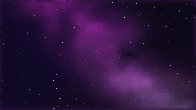

# claude-image-theme

[English](README.md) · **Tiếng Việt**

Biến một tấm ảnh bất kỳ thành mod theme cho Claude (Claude Code trên ứng dụng desktop và mobile).
Chỉ cần đưa vào một ảnh, công cụ sẽ:

1. **Trích bảng màu chủ đạo** từ ảnh (thuật toán k-means).
2. **Phối màu hài hòa**: nền trang, thẻ, khung chat nhuộm theo tông màu chính của ảnh; chữ dễ đọc; màu nhấn (accent), thành công, cảnh báo, lỗi, pro vẫn giữ đúng ý nghĩa (đỏ, xanh lá, vàng cam) nhưng ngả theo màu ảnh.
3. **Dùng ảnh làm hình nền**, được vẽ lại bằng vector (khảm màu làm mờ mềm, cộng với các điểm sáng trong ảnh thành sao lấp lánh), vì theme không nhúng được ảnh bitmap.
4. **Phủ một lớp mờ** lên ảnh (tối ở chế độ tối, sáng ở chế độ sáng) và **khung kính mờ** cho các panel, để chữ trong khung chat luôn dễ đọc.
5. **Kiểm tra độ tương phản** bằng chính bộ dựng màu của hệ thống thiết kế, tự chỉnh màu cho đến khi ứng dụng chấp nhận theme.

Kết quả là một thư mục mod sẵn sàng nạp: bảng màu, khung chat, viền, nút và chữ đều theo ảnh của bạn, giống phong cách theme không gian trong Antigravity.



## Yêu cầu

- Node.js 18 trở lên
- Claude Code có hỗ trợ mod (plugin hooks). Theme hiển thị trên ứng dụng **desktop** và **mobile**; terminal không vẽ theme.

## Bắt đầu nhanh

```bash
git clone https://github.com/ddtam2604work/claude-theme-from-image.git
cd claude-theme-from-image
npm install
node bin/generate.mjs "C:\Users\<ten-ban>\Pictures\space.jpg" --name space
```

Kết quả in ra:

```
Palette: #00292f 51%, #000c10 34%, #0c7046 4%, #0db9b0 3%, ...
  dark  text-primary on surface-0 16.8:1, text-muted on surface-0 8.8:1
Mod written to: ~/.claude/image-themes/image-theme-space
```

Sau đó nạp mod:

```bash
claude --plugin-dir ~/.claude/image-themes/image-theme-space
```

Với phiên do ứng dụng desktop khởi chạy, thêm thư mục vào biến `CLAUDE_CODE_PLUGIN_DIRS` (trong biến môi trường, hoặc khối `env` của `~/.claude/settings.json`):

```json
{ "env": { "CLAUDE_CODE_PLUGIN_DIRS": "C:\\Users\\<ten-ban>\\.claude\\image-themes\\image-theme-space" } }
```

Mở file `preview.svg` trong thư mục mod bằng trình duyệt để xem trước hình nền.

### Dùng thử theme mẫu

Repo này cũng là một marketplace plugin, có sẵn theme mẫu **Nebula** tạo từ `samples/nebula.png` (ảnh tự vẽ bằng thuật toán, không dùng tác phẩm của bên thứ ba). Gõ tại dấu nhắc của phiên Claude Code:

```
/plugin install image-theme-nebula --marketplace ddtam2604work/claude-theme-from-image
```

hoặc từ shell:

```bash
claude plugin install image-theme-nebula --marketplace ddtam2604work/claude-theme-from-image
```

## Tùy chọn

| Tùy chọn | Mặc định | Tác dụng |
| --- | --- | --- |
| `--name <slug>` | tên file | Mã theme; mod có tên `image-theme-<slug>` |
| `--label <chữ>` | từ name | Tên hiển thị trong ứng dụng |
| `--out <thư mục>` | `~/.claude/image-themes` | Nơi ghi thư mục mod |
| `--mode both\|dark\|light` | `both` | Tạo cả hai chế độ, hoặc chỉ một |
| `--veil <0..1>` | `0.45` | Độ tối của lớp phủ ở chế độ tối |
| `--veil-light <0..1>` | `0.7` | Độ sáng của lớp phủ ở chế độ sáng |
| `--glass <0..1>` | `0.55` | Độ đục của panel kính mờ |
| `--blur <0..64>` | `18` | Độ nhòe phía sau panel |
| `--detail <24..120>` | `96` | Số cột khảm màu (nhiều hơn = nét hơn, file lớn hơn) |
| `--stars <n>` | `120` | Số điểm sáng giữ lại từ ảnh |
| `--still` | tắt | Không chuyển động (không trôi, không lấp lánh) |

Mẹo:
- Ảnh nhiều chi tiết hoặc quá sáng, chữ khó đọc? Tăng `--veil` (ví dụ `0.6`) hoặc `--glass` (ví dụ `0.7`).
- Ảnh vũ trụ tối thường đẹp nhất với `--mode dark`.

## Trong ứng dụng

Mod thêm một lệnh slash mang tên mod:

- `/image-theme-space off` trả về giao diện mặc định
- `/image-theme-space on` bật lại theme

Ai đã bật "giảm chuyển động" trong hệ điều hành sẽ thấy hình nền đứng yên.

## Cách hoạt động

```
ảnh ──giải mã──► điểm ảnh ──lấy trung bình──► lưới 96×54 ──k-means(8)──► bảng màu
                                            │                                │
                                            │                     phân tích: tông chính,
                                            │                     màu nhấn, độ bão hòa
                                            ▼                                ▼
                         khảm k-means(40) + điểm sáng           makeColors(): nền, chữ, vai trò
                         + lớp phủ + chuyển động CSS             (kiểm tra tương phản, tự chỉnh)
                                            ▼                                ▼
                                  Cảnh nền (SVG)  ──►  $.theme.set({ colors, backdrop })
```

| File | Vai trò |
| --- | --- |
| `bin/generate.mjs` | Dòng lệnh: đọc ảnh, ghi mod |
| `lib/image.mjs` | Giải mã JPEG/PNG, lấy trung bình lưới, tìm điểm sáng, k-means |
| `lib/theme.mjs` | Phân tích bảng màu và định nghĩa theme (nền, chữ, màu vai trò) |
| `lib/scene.mjs` | Hình nền vector cùng lớp phủ và chuyển động |
| `lib/color.mjs` | Tính toán màu và độ tương phản WCAG |
| `template/hooks/register.tsx` | Phần mod: đặt theme, vẽ hình nền, thêm lệnh |
| `template/hooks/make-colors.js` | Bộ dựng màu của hệ thống thiết kế, lấy từ bộ công cụ viết mod của Claude Code |
| `mods/image-theme-nebula` | Mod mẫu đã tạo sẵn |

Mỗi mod tạo ra có file `hooks/look.generated.ts` chứa bảng màu, định nghĩa màu và cảnh SVG. Hãy chạy lại công cụ thay vì sửa tay.

## Giới hạn

- Theme chỉ hiển thị trên ứng dụng desktop và mobile.
- Hình nền là bản vẽ lại vector mềm của ảnh, không phải ảnh gốc: chi tiết nhỏ và chữ trong ảnh được làm mờ có chủ ý.
- `make-colors.js` theo phiên bản Claude Code mà nó được lấy ra. Sau bản cập nhật lớn của Claude Code, hãy lấy bản mới từ bộ công cụ viết mod rồi tạo lại theme.
- Chỉ dùng ảnh mà bạn có quyền sử dụng.

## Giấy phép

MIT
